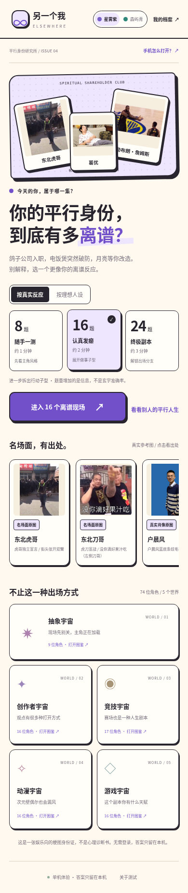
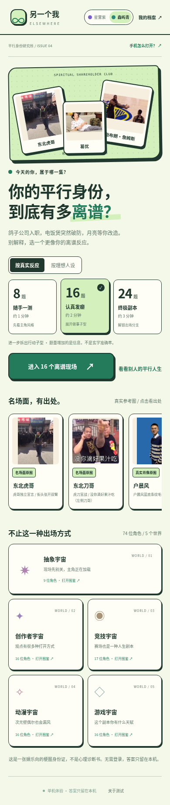

# V4 手机测试版

安卓手机请下载 APK，下载完成后使用系统安装器安装，再从桌面「另一个我」打开。首次安装可能需要允许当前浏览器安装应用。Android 8 及以上，并要求较新的 Android System WebView / Chrome；iPhone 无法安装 APK。

- [下载安卓 APK](https://github.com/Yangcrazy1/Basketball/raw/refs/heads/codex/parallel-self-v4/parallel-self/releases/v4/parallel-self-android.apk)
- [备用：下载单文件 HTML](https://github.com/Yangcrazy1/Basketball/raw/refs/heads/codex/parallel-self-v4/parallel-self/releases/v4/parallel-self.html)
- [完整源码与使用说明](../../README.md)
- [同类产品和开源选型](../../docs/v4-market-analysis.md)
- [文件 SHA-256](SHA256SUMS.txt)

这个目录中的文件就是可下载成品。HTML 在部分聊天或文件预览器内不会执行脚本；针对安卓截图，APK 为本次主要交付格式。APK 无登录、广告、后台服务或网络权限，题目与图片均在包内。系统保存 PNG 通过文件位置选择器完成；用户主动点击出处才会打开系统浏览器。

版本：4.0.0。24 道原创情境题、8/16/24 三档、74 位角色、两种配色、改单题重算、断点续答、最近 12 次档案、收藏、离线 PNG 身份卡。

公众人物的真实照片卡通重绘未完成：图像服务拒绝了生成。本版明确展示 8 张真实来源参考原图/线稿，与其余原创示意头像区分；没有把原图或想象头像冒充本轮重绘。出处和授权状态见源码，商用素材授权尚未全部确认。

## 检查范围

已运行引擎与浏览器流程检查；APK 编译、签名、对齐、无权限以及内置 HTML 一致性检查记录随源码提供。公开文件下载已于 2026-10-23 02:04 UTC 检查：APK 和 HTML 均返回 HTTP 200，重新下载的字节与本地成品完全一致。详情见 [`download-verification.json`](download-verification.json)；这不代表所有手机网络都可访问 GitHub。

没有连接手机或运行安卓模拟器，尚未完成真机安装、启动、系统文件选择器和分享器验收。

## 浏览器预览

以下为浏览器渲染截图，不是手机安装实拍。

| 星雾紫 | 森屿青 |
|---|---|
|  |  |

[查看结果页预览](preview-result.png)。
