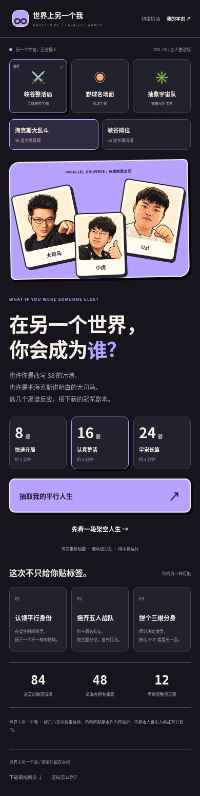
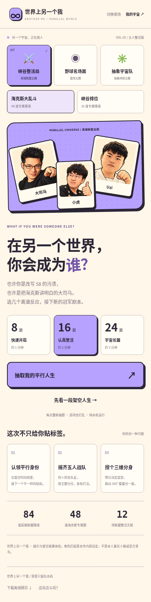

# 世界上另一个我 · 五人整活版

**[手机浏览器直接打开](https://yangcrazy1.github.io/Basketball/?v=5-hex)**

默认英雄联盟 / 海克斯大乱斗。也可切换峡谷排位；篮球和抽象网络为次要主题。

需要单文件时，打开网页后点页面底部「下载离线网页」，会下载约 1.8 MB 的 HTML。资源全部内置，无需安装 APK。部分文件预览器不执行网页脚本，在线入口不依赖本地文件预览。

- 84 道联盟情境，含 48 道海克斯专属题；每局随机抽 8/16/24 题。
- 12 项联盟天赋，三选一与一次重掷。
- 平行宇宙身份、架空 S8 剧本、你与四位队友的五人分位。
- 新大司马/Uzi/小虎参考重绘头像，360° 交互三维分身与 PNG 卡片。

公网验证已完成：HTTP 200、成品哈希一致、答题、天赋、五人阵容、三维旋转、PNG 和 HTML 实际下载、刷新回看均通过。详见 [验证记录](../docs/web-verification.json)。浏览器移动视口已验收，未声称完成实体手机硬件验收。

| 夜场 | 奶油 |
|---|---|
|  |  |

[平行身份与战队结果预览](preview-result.png) · [三维分身预览](preview-3d.png) · [源码说明](../README.md) · [文件校验](SHA256SUMS.txt)
